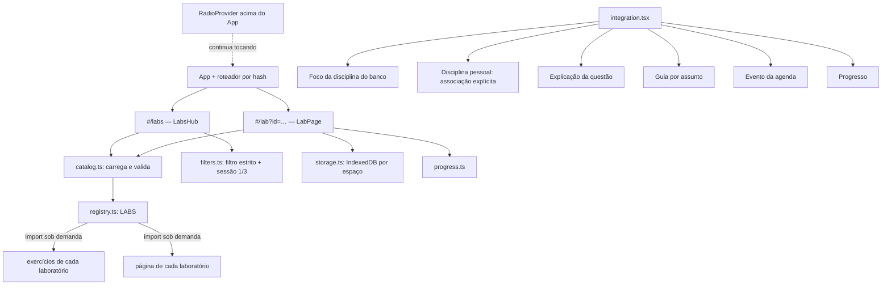
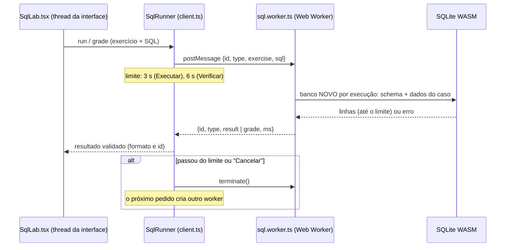
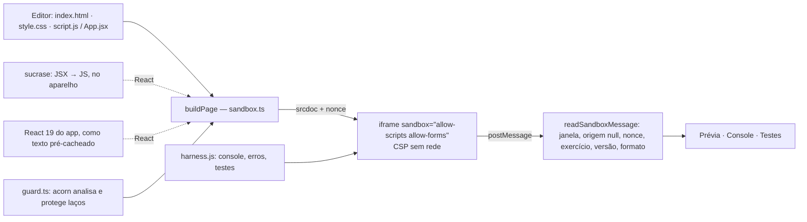

# Study Labs — prática executável (v0.7.0, em revisão)

Os Study Labs são uma modalidade nova, **separada do quiz e do banco de 600 questões**: o estudante escreve código ou
SQL, executa, vê o resultado e recebe correção pelo **comportamento**, não pelo texto da resposta.

Estado por PR (empilhados, sem merge):

| PR | Branch | Conteúdo |
|---|---|---|
| 1 | `feat/study-labs-core` | Core: tipos, registro, catálogo, filtros estritos, sessões, persistência, progresso, Hub, rotas e integrações |
| 2 | `feat/study-labs-sql` | SQL Lab: SQLite/WASM em Web Worker, 12 exercícios corrigidos pelo comportamento — depende do PR 1 |
| 3 | `feat/study-labs-web` | Web Lab (8, HTML/CSS/JS) e React Lab (4) em página isolada; versão 0.7.0 — depende do PR 2 |

## Arquitetura do Core

- **Sem novo roteador**: rotas `#/labs` (com `d`, `t`, `k` opcionais) e `#/lab?id=…&s=…` no `src/lib/route.ts`.
- **Registro** (`src/labs/registry.ts`): cada laboratório exporta um `LabDefinition` com nome, runtime, se funciona
  offline, `loadExercises()` e `loadPage()` — ambos carregados sob demanda. O Core não importa código de nenhum
  laboratório; incluir um novo é acrescentar uma entrada em `LABS`.
- **Falha isolada**: se o código de um laboratório não baixar (sem rede na primeira abertura), só a área do exercício
  mostra o aviso e “Tentar de novo” cria um carregamento novo (um `React.lazy` que falhou não tenta sozinho).
- **Study Radio**: o `RadioProvider` fica acima do `App`; abrir um laboratório não remonta o áudio.

## Modelo de exercício

`LabExerciseBase` (`src/labs/types.ts`): `id` estável, `version`, `kind`, disciplina e assuntos do banco, `skills`
(capacidades), dificuldade, profundidade (aula/aprofundamento/desafio), título, enunciado, objetivos, tempo estimado,
dicas graduais, explicação e `relations` (metadados para guias/materiais). Cada laboratório estende o modelo com os
dados do seu runtime e a configuração de avaliação. Exercícios **não** herdam de `Question`.

O catálogo valida cada exercício (id, versão, tipo, assuntos, capacidades conhecidas, dificuldade, profundidade,
objetivos, dicas, explicação, tempo) e descarta inválidos e ids repetidos; um laboratório cujo catálogo falha não
derruba os outros.

## Filtros estritos e disciplinas pessoais

- **Disciplina do banco** (Cálculo II, Full Stack): o exercício entra só se **todos** os assuntos dele estiverem
  marcados.
- **Disciplina pessoal**: o estudante associa, na página da disciplina, cada assunto às capacidades praticadas
  (`src/labs/skills.ts`, ex.: “Banco de Dados › Junções” → `sql.join`). Um exercício entra só se **todas** as
  capacidades dele estiverem associadas aos assuntos escolhidos. Nada é deduzido do nome da disciplina ou do material.
- Dificuldade, tipo de prática e profundidade (cumulativa, como no quiz) completam o filtro.
- **Sessões**: exercício rápido (1) ou sessão prática (3). Faltando exercícios, a sessão fica menor e o app diz isso;
  nunca completa com outros assuntos. Primeiro entram os não concluídos; a ordem vai do fácil ao difícil. A estrutura
  aceita até 5.
- Materiais enviados pelo estudante **não** viram exercícios executáveis automaticamente: um exercício precisa estar no
  catálogo validado.

## Persistência

IndexedDB `study-mastery-labs` (separado do progresso do quiz), com os dados de cada **espaço** (aparelho sem conta,
ou cada conta) isolados por chave:

| Store | Conteúdo |
|---|---|
| `drafts` | rascunho por exercício: versão do exercício, SQL ou arquivos, última edição (autosave com espera de 0,7 s; até 200 mil caracteres) |
| `attempts` | tentativas verificadas: versão, pontuação, aprovado, resultado de cada teste (até 2.000 por espaço) |
| `meta` | associações de assuntos pessoais, exercícios iniciados, tempo de prática, sessão atual |

- Ao trocar de app, bloquear a tela, recarregar ou sair do exercício, o que ainda esperava a gravação é salvo na hora
  (`pagehide`/`visibilitychange`, com `commit()` explícito da transação).
- Ao voltar, o rascunho é restaurado com aviso e opção “Começar do zero”. Rascunho de uma versão antiga do exercício
  não é aplicado sozinho: o estudante escolhe usar ou descartar.
- Sem IndexedDB (navegação privada, bloqueio), tudo funciona em memória e a tela avisa que não será guardado.
- **Nada disso vai para a conta ou servidor**: os dados dos laboratórios ficam só neste navegador.

## Progresso

Seção própria no Progresso e no Hub: exercícios iniciados, concluídos, tentativas, melhor pontuação, tempo
aproximado de prática (página aberta e em uso) e desempenho por laboratório. “Prática consolidada” de um assunto
exige 3 exercícios concluídos com ao menos um médio ou difícil. Um laboratório concluído **não** é somado aos
acertos do quiz.

## Integrações

Todas somem quando não há exercício compatível:

- Foco da disciplina do banco (`#/setup`): “Praticar estes assuntos nos Labs”.
- Disciplina pessoal: seção “Prática nos Labs” com a associação explícita de assuntos.
- Explicação de uma questão: “Praticar este assunto no Lab” (o quiz em andamento fica salvo).
- Guia (por assunto) e evento de estudo da agenda: “Praticar no Lab”. A lógica de planejamento não muda.
- Início: entrada “Study Labs”.

## Como adicionar um laboratório

1. Criar `src/labs/<tipo>/` com os exercícios (dados, sem funções) e a página (`LabPageProps`).
2. Exportar um `LabDefinition` (`kind`, `name`, `runtime`, `offline`, `note`, `loadExercises`, `loadPage`).
3. Incluir em `LABS` (`src/labs/registry.ts`) e, se precisar, novas capacidades em `skills.ts`.
4. Testes: os exercícios passam por `exerciseProblems`; a correção do laboratório tem testes próprios.

## Testes do Core

- `src/labs/__tests__/core.test.ts`: validação do catálogo, falha isolada, filtros estritos (banco e pessoal), sessão
  sem completar, progresso separado, rotas.
- `src/labs/__tests__/storage.test.ts`: IndexedDB real em memória (`fake-indexeddb`): reabrir recupera, espaços
  isolados, limite de rascunho, fallback em memória.
- `src/labs/__tests__/LabPage.test.tsx` (jsdom): autosave e restauração, “começar do zero”, dicas graduais, tentativa
  e explicação, falha de carregamento com nova tentativa, sessão, Hub com filtro estrito.

## SQL Lab (PR 2)

SQL de verdade, executado por um **SQLite 3.49 compilado para WebAssembly** (sql.js 1.14.2) dentro de um **Web
Worker**, no aparelho do estudante. Nada vai para servidor, e não há conexão com bancos externos nem com os dados do
Study Mastery.

### Interface

Na página do exercício (o Core mostra enunciado, objetivos, dificuldade, assunto, dicas graduais, histórico e
explicação):

1. **Dialeto deste laboratório: SQLite.** com as diferenças para o MySQL 8 que importam;
2. banco do exercício (“Banco Loja/Biblioteca/Universidade”): tabelas, colunas, chave primária, obrigatórios, até 50
   linhas por tabela e o SQL de criação;
3. editor (textarea monoespaçado, 16 px, sem corretor/autocapitalização; Ctrl+Enter executa; Tab sai do campo);
4. **Executar** (banco do enunciado), **Verificar resposta** (todos os bancos de teste), **Cancelar** durante a
   execução e **Restaurar exercício** (com confirmação; as tentativas continuam no histórico);
5. tabela de resultado com NULL visível, números alinhados e rolagem própria (a página não rola de lado);
6. erros do SQLite traduzidos em orientação, com a mensagem original entre parênteses;
7. resultado por banco de teste e “Resposta correta!” quando concluído.

No celular tudo fica em uma coluna; a partir de 1000 px, editor e resultado ficam lado a lado.

### Exercícios (12, originais)

| id | Conteúdo | Dificuldade | Profundidade | Correção | Bancos de teste |
|---|---|---|---|---|---|
| `sql-produtos-ate-50` | SELECT, WHERE, ORDER BY com desempate | fácil | aula | resultado, ordem | enunciado · limite 50,00/50,01 · vazio |
| `sql-tres-mais-caros` | ORDER BY DESC, LIMIT | fácil | aula | resultado, ordem | enunciado · empate na fronteira · menos de 3 |
| `sql-clientes-sem-cidade` | IS NULL × texto vazio | fácil | aula | resultado, ordem | enunciado · '' não é NULL · nenhum |
| `sql-pedidos-com-cliente` | JOIN pela chave estrangeira | médio | aula | resultado, ordem | enunciado · homônimos · cliente sem pedido |
| `sql-clientes-sem-pedido` | LEFT JOIN / NOT EXISTS | médio | aprofundamento | resultado, ordem | enunciado · homônimos · todos compraram |
| `sql-resumo-por-categoria` | GROUP BY, COUNT, AVG | médio | aula | resultado (tolerância 0,01) | enunciado · média com dízima · uma categoria |
| `sql-clientes-acima-de-100` | 2 JOINs, SUM, HAVING | difícil | aprofundamento | resultado, ordem (tolerância) | enunciado · exatamente 100 · homônimos |
| `sql-livros-acima-da-media` | subconsulta escalar, AVG e NULL | médio | aprofundamento | resultado, ordem | enunciado · todos iguais · média quebrada + NULL |
| `sql-reajuste-papelaria` | UPDATE … WHERE | médio | aula | estado final | enunciado · sem a categoria · categorias misturadas |
| `sql-limpar-emprestimos` | DELETE com datas e NULL | médio | aula | estado final | enunciado · dia da virada · aberto antigo |
| `sql-matricular-turma` | INSERT e INSERT … SELECT | difícil | desafio | estado final (2 tabelas) | enunciado · ids já usados · nenhum aluno do curso |
| `sql-criar-avaliacoes` | CREATE TABLE, PK, NOT NULL, FK, CHECK | médio | aprofundamento | estrutura por sondas (8) | regras da tabela |

Todos na disciplina **Desenvolvimento Web Full Stack**, assunto **MySQL e persistência**.

### Correção pelo comportamento

O SQL do estudante **nunca é comparado com o texto de um gabarito**. Em cada banco de teste (o do enunciado e casos
adicionais escritos para pegar erros comuns), a solução de referência e a do estudante rodam em bancos novos e o
**resultado** é comparado:

- **Consultas** (`result`): linhas como multiconjunto (duplicatas contam); NULL só é igual a NULL; números com
  tolerância por exercício (arredondar a média para 2 casas é aceito; para inteiro, não); texto exato. Colunas com os
  mesmos nomes em outra ordem são realinhadas; nomes diferentes são comparados pela posição (alias não é exigido, a
  menos que o exercício peça). Quando o enunciado pede ordem, ela é conferida pela **chave pedida** (ex.: preço, depois
  nome): empates fora da chave não viram erro falso.
- **INSERT/UPDATE/DELETE** (`state`): compara o estado final das tabelas por consultas de verificação.
- **CREATE TABLE** (`schema`): confere as colunas e roda sondas que precisam funcionar ou ser recusadas (nota 6,
  produto inexistente, id repetido…), dentro de um SAVEPOINT desfeito depois de cada sonda.

O feedback diz **o que** está diferente sem mostrar a solução: número de colunas, de linhas, duplicatas a mais ou a
menos, NULL trocado por valor, valores diferentes, ordem, estado final, restrição que não conferiu, ou o erro do banco
traduzido. Cada caso adicional traz uma dica (“Há duas clientes chamadas Ana Souza e só uma comprou…”). Alguns
sintomas no texto só **escolhem uma dica** (ex.: `= NULL` → “use IS NULL”; `/` → divisão inteira do SQLite); a nota
vem sempre do comportamento. Em exercícios de **desafio** o feedback dá menos pistas (sem a dica do caso e sem
números exatos).

Durante as tentativas a tela não mostra a solução: só as dicas graduais. A explicação (com o raciocínio e o comando
principal) aparece depois de concluir.

> **Transparência:** a correção roda no navegador. Soluções de referência e bancos de teste estão no código do app e
> **não são secretos** — quem quiser pode lê-los. Os Labs servem para praticar e aprender, não para avaliação formal.

### Limites e isolamento

| Limite | Valor |
|---|---|
| tamanho do SQL | 20.000 caracteres |
| linhas mostradas | 1.000 (aviso de corte) |
| linhas lidas na correção | 5.000 (acima disso: “resultado grande demais”) |
| comandos por envio | 50 |
| tempo | 3 s (Executar), 6 s (Verificar), 20 s para carregar o SQLite |
| memória do SQLite | 64 MB (`PRAGMA hard_heap_limit`): alocação gigante vira erro |
| tamanho do banco | ~8 MB (`PRAGMA max_page_count`) |

- Passou do tempo ou “Cancelar”: o worker é **encerrado** (`terminate`), a única forma de parar um laço infinito
  no SQLite, e o próximo pedido cria outro. A interface continua respondendo enquanto o SQL roda (medido no e2e: ~10
  ms de latência durante um laço infinito).
- O SQL do estudante é interpretado pelo SQLite, que **não executa JavaScript**, não tem funções de rede e não carrega
  extensões (`load_extension` não existe no runtime). Cada execução usa um banco em memória **novo**, descartado em
  seguida: um `DROP TABLE` não afeta a próxima execução nem a correção.
- O worker não recebe nada além do exercício e do SQL: nenhum dado do estudante, token ou material.
- Chaves estrangeiras ligadas (`PRAGMA foreign_keys = ON`), como no InnoDB.

### SQLite × MySQL 8

Os exercícios usam SQL comum aos dois. As diferenças abaixo foram **conferidas rodando nos dois bancos** (SQLite do
laboratório × MariaDB 10.11.14 com o `sql_mode` padrão do MySQL 8) por `npm run labs:sql-portability`:

| Caso | SQLite (laboratório) | MySQL 8 / MariaDB |
|---|---|---|
| `SELECT 5 / 3` | `1` (divisão inteira) | `1.6667` |
| `'ana' = 'ANA'` | falso | verdadeiro (colação padrão) |
| `'a' \|\| 'b'` | `'ab'` | `0` (`\|\|` é OU lógico; use `CONCAT`) |
| `LENGTH('ção')` | `3` (caracteres) | `5` (bytes; use `CHAR_LENGTH`) |
| coluna fora do `GROUP BY` | aceita | erro (ONLY_FULL_GROUP_BY) |
| `CURDATE()` | não existe (`date('now')`) | existe |
| texto `'abc'` numa coluna INTEGER | aceita | erro em modo estrito |

Outras diferenças documentadas (não exercitadas): `AUTOINCREMENT` × `AUTO_INCREMENT`; tipos do SQLite são afinidades
(`DECIMAL(10,2)` guarda 2.00 como inteiro 2 — por isso `SUM(preco) / COUNT(*)` pode virar divisão inteira; o feedback
explica); no MySQL 8 o `REFERENCES` escrito na própria coluna é aceito e ignorado (use `FOREIGN KEY` separada); CHECK
vale a partir do MySQL 8.0.16.

**Portabilidade dos exercícios:** o mesmo comando sobe um MariaDB temporário e roda schema, dados e a solução de
referência de cada exercício e banco de teste, comparando com o SQLite. Resultado nesta versão: **os 12 exercícios
se comportam igual** (inclusive as 8 sondas de restrição do `CREATE TABLE`). Limites desta verificação: MariaDB 10.11
é próximo, mas não idêntico, ao MySQL 8 (colações e alguns erros diferem); confere-se a solução de referência, não
toda resposta possível do estudante. Um exercício que dependa de sintaxe só do MySQL não seria validado pelo SQLite e,
por isso, não entra no catálogo.

### Offline e PWA

O worker (`sql.worker-*.js`, 54 KB), o WebAssembly (`sql-wasm-*.wasm`, 658 KB; 323 KB com gzip), a página e o
catálogo entram no **pré-cache** do service worker: depois de instalado, o SQL Lab funciona sem internet, inclusive
num exercício nunca aberto (verificado no e2e, na raiz e no subcaminho). O `public/sw.js` **não foi alterado**: o
plugin `tools/pwa.ts` já pré-cacheia tudo de `dist/` exceto `OPTIONAL_ASSET`, e o WebAssembly é resolvido a partir do
endereço do próprio worker (funciona em subcaminho). Custo: o pré-cache passou de 2,41 MB para 3,21 MB.

### Testes do SQL Lab

- `src/labs/sql/__tests__/engine.test.ts` (44, SQLite real): catálogo; solução de referência passa em todos os bancos
  e o código inicial não; 17 soluções **equivalentes** passam (aliases, outra ordem de colunas, NOT EXISTS, NOT IN,
  CTE, subconsultas, ROUND, IN, id da disciplina nova por subconsulta, REFERENCES na coluna); soluções **erradas** falham com o
  feedback esperado (limite, desempate, `= NULL`, '' × NULL, JOIN errado, homônimos, arredondamento, HAVING × WHERE,
  média fixa, UPDATE sem WHERE, DELETE pela data errada, id fixo, CHECK/FK ausentes, sintaxe, divisão inteira);
  limites (linhas, tamanho, comandos, memória) e isolamento (banco novo, sem extensões, FKs).
- `compare.test.ts` (10): NULL, tolerância, duplicatas, alinhamento de colunas, ordem com empates, feedback.
- `client.test.ts` (8): fila, limite de tempo com worker recriado, cancelamento, falha do worker, mensagens
  malformadas ignoradas, nova tentativa de carga, runner compartilhado (também com StrictMode), validação do protocolo.
- `SqlLab.test.tsx` (7, jsdom + SQLite real): dialeto, Executar com NULL, erro traduzido, Ctrl+Enter, verificação
  errada/certa com histórico e explicação, rascunho e restaurar, dados, tempo esgotado, falha ao carregar.
- `npm run e2e:labs` (Chromium, build de produção; 53 verificações no total com o Web/React Lab): ver a seção de testes
  de navegador abaixo.
- `npm run labs:sql-portability`: comparação com MariaDB descrita acima.

### Testes de navegador (`npm run e2e:labs`)

Build de produção servido no subcaminho do GitHub Pages e na raiz (como no Cloudflare Pages), Chromium:
Hub com contagem e filtro estrito; “Exercício rápido”; worker e WebAssembly carregando nos dois caminhos; Executar
com NULL; verificação errada e certa; laço infinito interrompido no limite com a interface respondendo; worker novo
depois do limite; Cancelar; rascunho restaurado mesmo recarregando logo após digitar; Restaurar exercício; **offline**
(exercício nunca aberto, DDL e UPDATE corrigidos, Hub); 360/390/768/1280 px sem rolagem lateral; axe-core WCAG 2.2
A/AA sem violações nos temas claro e escuro (verificação automática, não é auditoria completa); Tab sai do editor;
alvos de toque ≥ 44 px e editor com 16 px; **Study Radio continua tocando** sem recarregar; nenhuma requisição a
outros domínios; sem erros de página. Capturas em `docs/screenshots/labs/`.

### Como testar manualmente

1. `npm run build && npm run preview`, abrir o app e tocar em **Study Labs** no Início.
2. Escolher Full Stack › MySQL e persistência › **Exercício rápido**, ou abrir `#/lab?id=sql-clientes-sem-cidade`.
3. Executar `SELECT * FROM clientes;`, depois verificar `… WHERE cidade = NULL` (falha com dica) e `… IS NULL`
   (conclui e libera a explicação).
4. Rodar `WITH RECURSIVE n(x) AS (SELECT 1 UNION ALL SELECT x + 1 FROM n) SELECT COUNT(*) FROM n;` — interrompe em 3 s;
   a página continua usável.
5. Desligar a rede (DevTools › Offline), recarregar e abrir outro exercício: tudo funciona.

## Web Lab e React Lab (PR 3)

HTML, CSS e JavaScript (Web Lab, 8 exercícios) e React 19 com JSX (React Lab, 4 exercícios). O código do estudante
roda **só dentro de uma página isolada** (iframe); a página do Study Mastery monta o documento, mostra a prévia, o
console e os testes.

### Interface

- Abas de arquivo (`index.html`, `style.css`, `script.js` ou `App.jsx`); arquivos de apoio aparecem **somente leitura**.
- **Executar** (Ctrl+Enter) monta uma página nova; **Verificar resposta** roda os testes; **Restaurar exercício**
  com confirmação. Rascunho dos arquivos editáveis salvo no aparelho enquanto digita (mesmo mecanismo do Core).
- **Prévia** com largura selecionável (celular 360 px, tablet 768 px, largura disponível) para conferir media queries.
- **Console didático**: `console.log/info/warn/error` (objetos, arrays e elementos formatados), erros com a **linha do
  editor** (`script.js:3 — …`), recursos bloqueados explicados, limite de 200 mensagens.
- **Testes**: a lista do que será conferido aparece antes; depois, o resultado de cada um com o motivo da falha.
- No celular, **Código / Prévia / Console / Testes** são abas; a partir de 1000 px ficam lado a lado.

### Exercícios

| id | Assunto (banco) | Capacidades | Dificuldade | Profundidade | Testes |
|---|---|---|---|---|---|
| `web-pagina-semantica` | HTML semântico | html.semantic | fácil | aula | 3 |
| `web-formulario-acessivel` | HTML semântico | html.forms | médio | aula | 4 |
| `web-barra-flex` | CSS | css.layout | fácil | aula | 2 |
| `web-galeria-mobile-first` | CSS | css.responsive, css.layout | médio | aprofundamento | 3 (360/700/1000 px) |
| `web-funcoes-carrinho` | JS: funções puras e arrays | js.arrays | fácil | aula | 3 |
| `web-filtrar-ordenar` | JS: funções puras e arrays | js.arrays, js.dom | médio | aprofundamento | 3 |
| `web-validacao-cadastro` | Classes, validação e erros | js.validation | médio | aprofundamento | 4 |
| `web-lista-tarefas` | JS: funções puras e arrays | js.dom, js.arrays | difícil | desafio | 3 |
| `react-cartoes-props` | React: componentes | react.components | fácil | aula | 2 |
| `react-contador` | React: hooks e formulários | react.state | fácil | aula | 3 |
| `react-formulario-controlado` | React: hooks e formulários | react.forms, react.state | médio | aprofundamento | 4 |
| `react-busca-lista` | React: hooks e formulários | react.state, react.forms | médio | aprofundamento | 3 |

Todos originais, na disciplina Desenvolvimento Web Full Stack. No e2e, **o código inicial de cada um falha e a solução
de referência passa** no Chromium.

### Testes declarativos

Os testes são **dados** (sem funções no exercício): o harness dentro da página isolada os executa sobre a página do
estudante, cada teste numa **página nova** (iframe fora da tela, na largura do teste) para não herdar estado.

| Verificação | O que confere |
|---|---|
| `exists`, `count` | elementos pelo seletor (mínimo/máximo) |
| `text`, `attr`, `value`, `disabled` | texto (normalizado), atributos, valor e estado de campos |
| `style`, `columns`, `fits` | estilo calculado, colunas reais do grid, ausência de rolagem lateral |
| `labelled` | nome acessível de campos (label, aria-label, aria-labelledby) |
| `call` (+ `pure`) | chama a função do script com outros dados e confere o retorno — e que o array recebido não foi modificado |
| `throws` | a função lança o erro customizado certo, com as propriedades certas |
| `no-errors` | o script não gerou erro |

Passos de interação: preencher (com o setter nativo + eventos `input`/`change`, o que funciona com campos controlados
do React), clicar e enviar formulário (`requestSubmit`). Funções declaradas com `const`/`let` também são alcançadas: o
app acrescenta ao fim do script uma exportação só dos nomes que o exercício lista.

### Isolamento e segurança

| Camada | Como | Verificado no e2e |
|---|---|---|
| iframe `sandbox="allow-scripts allow-forms"` **sem** `allow-same-origin` | origem opaca: sem DOM do app, sem `localStorage`, cookies, IndexedDB ou service worker; sem popups, navegação da janela principal ou `alert` | localStorage, cookie, IndexedDB, `parent.document`, `window.open` e `top.location` bloqueados; URL e armazenamento do app intactos |
| `allow-forms` | só para o evento `submit` existir nos exercícios de formulário. Envio para outro endereço é barrado pelo CSP (`form-action 'none'`); envio sem `preventDefault` é cancelado pelo harness e explicado no console. `form.submit()` (que pula o evento) só recarrega a própria página isolada — sem rede — e, durante a verificação, o teste falha explicando o recarregamento | conferido à parte no Chromium: envio externo recusado pelo CSP, nenhuma requisição; recarregar o `about:srcdoc` não é barrado pelo CSP (por isso o harness e o runner tratam o caso) |
| CSP no documento | `default-src 'none'`; scripts e estilos só embutidos; sem `connect`, `img` externo, `frame`, `worker`, `object` | `fetch` externo, `fetch` ao próprio app e imagem externa bloqueados; nenhuma requisição a outros domínios |
| Navegação do iframe | a CSP não cobre a navegação do próprio iframe. Cliques em links para fora são barrados pelo harness; se o script trocar o documento (`location.href = …`), a página do app percebe (documento carregado sem o harness) e encerra a prévia com uma explicação | link externo barrado; `location.href` para fora: prévia encerrada |
| Mensagens | aceitas só da janela daquele iframe, origem `"null"`, versão do protocolo, **nonce** da execução, exercício, versão e formato, com textos cortados | mensagem forjada de “teste aprovado” ignorada (unitário e e2e) |
| Laços | `guard.ts` (acorn, sem executar) insere `__smLoop()` em todo `for/while/do…while`; o harness interrompe o laço que rodar 1,5 s sem devolver o controle | `while (true)` no script e `for (;;)` num evento interrompidos; interface do app respondendo |
| Watchdog | com a prévia visível, 6 s sem batimento do harness descartam o iframe | — |
| Dados | o documento leva só os arquivos do exercício, o código do estudante, o harness e (React) o runtime — nada de dados do estudante, tokens ou materiais | — |

`eval`/`new Function` ficam bloqueados pelo CSP (sem `'unsafe-eval'`), então todo laço passa pela proteção.

**Riscos residuais (documentados, não resolvidos):**

- O código do estudante roda **junto** do harness e pode adulterá-lo (sobrescrever funções do DOM, forjar o próprio
  resultado com acesso ao nonce em memória). Os testes são **educativos, não à prova de fraude**; a página valida a
  origem e o formato, mas não pode provar que o harness não foi alterado.
- Travamentos **sem laço** (expressão regular catastrófica, recursão profunda em APIs nativas) não passam pela
  proteção. No Chromium de desktop usado nos testes o iframe isolado roda em **outro processo** e a interface do app
  continuou respondendo (medido no e2e). Em navegadores sem isolamento de processos para iframes isolados — comum no
  **Android** — o iframe pode compartilhar a thread da página e travá-la até o laço terminar; o watchdog só age depois.
  Não foi possível testar em aparelho Android real neste ambiente.
- Atributos de evento no HTML (`onclick="…"`) não são instrumentados (raro nos exercícios).
- **Navegação por script**: `location.href = 'https://…'` no código do estudante faz o iframe pedir aquele endereço — a
  CSP não cobre navegação e a Navigation API não emite eventos em documentos de origem opaca, então não há como
  impedir o pedido no navegador. O app detecta a troca de documento e encerra a prévia (verificado no e2e). Exige ação
  do próprio código do estudante, e o iframe continua isolado (origem opaca, sem dados do app).

### React Lab: runtime local em vez do Sandpack

O pedido citava **Sandpack**. Ele executa o código num bundler hospedado pela CodeSandbox (outro domínio): exige
internet, envia o código do estudante a terceiros e **não estava acessível neste ambiente** (conexão recusada), então
não seria possível verificar que funciona. A alternativa adotada, testada e offline:

- **sucrase 3.35.1** transforma JSX e `import/export` no aparelho (só análise de texto; mantém os números de linha);
- o **React 19 do próprio app** é empacotado no build como script clássico (`tools/react-runtime.ts`, módulo virtual
  com licença MIT preservada) e **embutido no documento isolado** — o sandbox não baixa nada;
- `import` de outros pacotes gera erro explicado (“Pacote não disponível no laboratório”).

Por isso o React Lab é anunciado como **offline** (verificado no e2e, na raiz). Se o Sandpack for desejado como modo
online opcional (mais pacotes npm), é um próximo passo separado, com aviso de rede e de envio do código a terceiros.

### Offline, tamanho e desempenho

Tudo entra no pré-cache e é baixado só ao abrir um exercício do tipo:

| Chunk | Tamanho |
|---|---|
| página do Web/React Lab (inclui acorn) | 156 KB |
| sucrase (JSX) | 207 KB |
| runtime do React para o sandbox (texto) | 223 KB |
| exercícios Web/React | 41 KB |

Pré-cache total: **2,41 MB** (base 0.6.1) → **3,21 MB** (com SQL Lab) → **3,84 MB** (com Web/React Lab). O chunk
principal do app cresceu ~37 KB (Core dos Labs; os laboratórios em si carregam sob demanda). `public/sw.js` não mudou.

### Testes do Web Lab

- `src/labs/web/__tests__/sandbox.test.ts` (13): proteção de laços (todos os tipos, linhas preservadas, sintaxe
  inválida), montagem do documento (CSP e harness no topo, CSS/script no lugar, escape de `</script>`, linha do
  script, `defer`, erro de sintaxe, React), atributo sandbox e CSP, validação de mensagens (janela, origem, nonce,
  exercício, versão, tipo, formato, tamanho), catálogo.
- `WebLab.test.tsx` (3, jsdom): abas de arquivo e de painel, iframe com sandbox/CSP, arquivo só leitura, rascunho só
  dos editáveis, restaurar, falha ao carregar o React com nova tentativa.
- `npm run e2e:labs` (Chromium): os 12 exercícios (inicial falha, solução passa), prévia, console com linha, laço
  infinito no script e em evento, isolamento (armazenamento, DOM, popups, navegação da janela principal, rede), link
  externo barrado, navegação por script encerrando a prévia, mensagem forjada,
  React (renderiza, cliques, erro de JSX, pacote externo), axe nas quatro abas, 360–1280 px, layout lado a lado,
  offline (React e validação), medição informativa de travamento sem laço.

## Math Lab (futuro, não implementado)

Exercícios de Cálculo II executáveis exigem um runtime matemático confiável; nada disso foi implementado nesta versão.

- **Correção simbólica/numérica**: comparar a expressão do estudante com a esperada por avaliação em vários pontos
  (com tolerância e cuidado com domínios), e não por texto — o mesmo princípio do SQL Lab.
- **Runtime candidato**: um parser/avaliador de expressões no navegador (ex.: math.js) para derivadas/integrais
  conferidas numericamente; Pyodide + SymPy (WebAssembly, ~10 MB) daria simplificação simbólica, mas pesa no celular.
  O projeto já usa SymPy no pipeline editorial (servidor/CLI), não no app.
- **Entrada**: editor com prévia em KaTeX (já usado no app) e teclado matemático no celular.
- **Isolamento**: avaliar expressões num Web Worker, com limite de tempo, como no SQL Lab.
- Disciplinas pessoais só entrariam por associação explícita a capacidades novas (`math.*`).

Nenhuma disciplina executa código ou matemática automaticamente sem um runtime compatível registrado em `LABS`.
