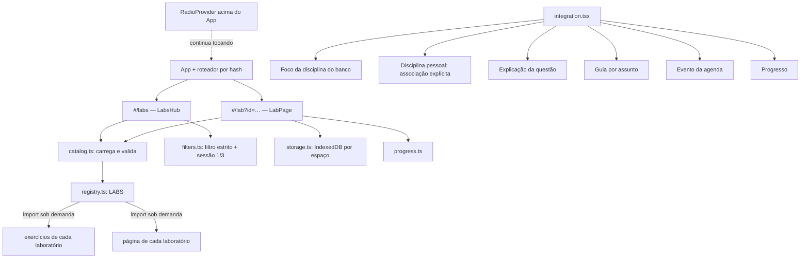

# Study Labs — prática executável (v0.7, em revisão)

Os Study Labs são uma modalidade nova, **separada do quiz e do banco de 600 questões**: o estudante escreve código ou
SQL, executa, vê o resultado e recebe correção pelo **comportamento**, não pelo texto da resposta.

Estado por PR (empilhados, sem merge):

| PR | Branch | Conteúdo |
|---|---|---|
| 1 | `feat/study-labs-core` | Core: tipos, registro, catálogo, filtros estritos, sessões, persistência, progresso, Hub, rotas e integrações |
| 2 | `feat/study-labs-sql` | SQL Lab (SQLite/WASM em Web Worker) — depende do PR 1 |
| 3 | `feat/study-labs-web` | Web Lab (HTML/CSS/JS e React) — depende do PR 2 |

## Arquitetura do Core

- **Sem novo roteador**: rotas `#/labs` (com `d`, `t`, `k` opcionais) e `#/lab?id=…&s=…` no `src/lib/route.ts`.
- **Registro** (`src/labs/registry.ts`): cada laboratório exporta um `LabDefinition` com nome, runtime, se funciona
  offline, `loadExercises()` e `loadPage()` — ambos carregados sob demanda. O Core não importa código de nenhum
  laboratório; incluir um novo é acrescentar uma entrada em `LABS`.
- **Falha isolada**: se o código de um laboratório não baixar (sem rede na primeira abertura), só a área do exercício
  mostra o aviso e “Tentar de novo” cria um carregamento novo (um `React.lazy` que falhou não tenta sozinho).
- **Study Radio**: o `RadioProvider` fica acima do `App`; abrir um laboratório não remonta o áudio.

## Modelo de exercício

`LabExerciseBase` (`src/labs/types.ts`): `id` estável, `version`, `kind`, disciplina e assuntos do banco, `skills`
(capacidades), dificuldade, profundidade (aula/aprofundamento/desafio), título, enunciado, objetivos, tempo estimado,
dicas graduais, explicação e `relations` (metadados para guias/materiais). Cada laboratório estende o modelo com os
dados do seu runtime e a configuração de avaliação. Exercícios **não** herdam de `Question`.

O catálogo valida cada exercício (id, versão, tipo, assuntos, capacidades conhecidas, dificuldade, profundidade,
objetivos, dicas, explicação, tempo) e descarta inválidos e ids repetidos; um laboratório cujo catálogo falha não
derruba os outros.

## Filtros estritos e disciplinas pessoais

- **Disciplina do banco** (Cálculo II, Full Stack): o exercício entra só se **todos** os assuntos dele estiverem
  marcados.
- **Disciplina pessoal**: o estudante associa, na página da disciplina, cada assunto às capacidades praticadas
  (`src/labs/skills.ts`, ex.: “Banco de Dados › Junções” → `sql.join`). Um exercício entra só se **todas** as
  capacidades dele estiverem associadas aos assuntos escolhidos. Nada é deduzido do nome da disciplina ou do material.
- Dificuldade, tipo de prática e profundidade (cumulativa, como no quiz) completam o filtro.
- **Sessões**: exercício rápido (1) ou sessão prática (3). Faltando exercícios, a sessão fica menor e o app diz isso;
  nunca completa com outros assuntos. Primeiro entram os não concluídos; a ordem vai do fácil ao difícil. A estrutura
  aceita até 5.
- Materiais enviados pelo estudante **não** viram exercícios executáveis automaticamente: um exercício precisa estar no
  catálogo validado.

## Persistência

IndexedDB `study-mastery-labs` (separado do progresso do quiz), com os dados de cada **espaço** (aparelho sem conta,
ou cada conta) isolados por chave:

| Store | Conteúdo |
|---|---|
| `drafts` | rascunho por exercício: versão do exercício, SQL ou arquivos, última edição (autosave com espera de 0,7 s; até 200 mil caracteres) |
| `attempts` | tentativas verificadas: versão, pontuação, aprovado, resultado de cada teste (até 2.000 por espaço) |
| `meta` | associações de assuntos pessoais, exercícios iniciados, tempo de prática, sessão atual |

- Ao trocar de app, bloquear a tela, recarregar ou sair do exercício, o que ainda esperava a gravação é salvo na hora
  (`pagehide`/`visibilitychange`, com `commit()` explícito da transação).
- Ao voltar, o rascunho é restaurado com aviso e opção “Começar do zero”. Rascunho de uma versão antiga do exercício
  não é aplicado sozinho: o estudante escolhe usar ou descartar.
- Sem IndexedDB (navegação privada, bloqueio), tudo funciona em memória e a tela avisa que não será guardado.
- **Nada disso vai para a conta ou servidor**: os dados dos laboratórios ficam só neste navegador.

## Progresso

Seção própria no Progresso e no Hub: exercícios iniciados, concluídos, tentativas, melhor pontuação, tempo
aproximado de prática (página aberta e em uso) e desempenho por laboratório. “Prática consolidada” de um assunto
exige 3 exercícios concluídos com ao menos um médio ou difícil. Um laboratório concluído **não** é somado aos
acertos do quiz.

## Integrações

Todas somem quando não há exercício compatível:

- Foco da disciplina do banco (`#/setup`): “Praticar estes assuntos nos Labs”.
- Disciplina pessoal: seção “Prática nos Labs” com a associação explícita de assuntos.
- Explicação de uma questão: “Praticar este assunto no Lab” (o quiz em andamento fica salvo).
- Guia (por assunto) e evento de estudo da agenda: “Praticar no Lab”. A lógica de planejamento não muda.
- Início: entrada “Study Labs”.

## Como adicionar um laboratório

1. Criar `src/labs/<tipo>/` com os exercícios (dados, sem funções) e a página (`LabPageProps`).
2. Exportar um `LabDefinition` (`kind`, `name`, `runtime`, `offline`, `note`, `loadExercises`, `loadPage`).
3. Incluir em `LABS` (`src/labs/registry.ts`) e, se precisar, novas capacidades em `skills.ts`.
4. Testes: os exercícios passam por `exerciseProblems`; a correção do laboratório tem testes próprios.

## Testes do Core

- `src/labs/__tests__/core.test.ts`: validação do catálogo, falha isolada, filtros estritos (banco e pessoal), sessão
  sem completar, progresso separado, rotas.
- `src/labs/__tests__/storage.test.ts`: IndexedDB real em memória (`fake-indexeddb`): reabrir recupera, espaços
  isolados, limite de rascunho, fallback em memória.
- `src/labs/__tests__/LabPage.test.tsx` (jsdom): autosave e restauração, “começar do zero”, dicas graduais, tentativa
  e explicação, falha de carregamento com nova tentativa, sessão, Hub com filtro estrito.
